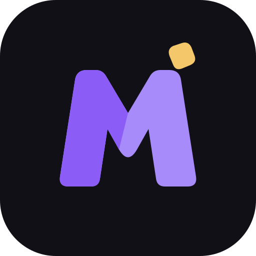

<p align="center"></p>

# MegaNugget

**Твики для старых iPhone без джейлбрейка.** В проекте есть приложение для iPhone
на SwiftUI и Desktop-программа для компьютера, которая подписывает и устанавливает его.
Desktop сейчас написан на Tauri и переписывается на C++ и Qt 6.
Первая цель — **iPhone 7 (iPhone9,1 и iPhone9,3) на iOS 15.8.8**. Пока это только цель
разработки: системные твики к телефону ещё не применяются.

MegaNugget включает **частичный порт кода GoldenNugget Mobile** авторства
**awesomenull-dev и участников GoldenNugget Team**:
[исходный проект](https://github.com/GoldenNugget-Team/GoldenNugget-mobile).
Это не официальный клиент и не готовый backport всех функций. Полные исходные
Credits и лицензия сохранены в `LICENSES/GoldenNuggetMobile-*`; собственные
брендинг и интерфейс MegaNugget не используют графику upstream.

**Изменения от upstream (2026-11-06):** Foundation-каталог/компилятор интегрированы
в MegaNuggetCore, добавлены строгие gates iOS 15–17 и оборудования, ограничение
компиляции выбранными spec и новый редактор локальных XML-черновиков.
Системное применение не перенесено. Подробности: [GOLDENNUGGET_PORT.md](docs/GOLDENNUGGET_PORT.md).

Направление Dopamine остановлено. Старый `jb-orchestrator` оставлен для истории,
исключён из Cargo default-members и не подключён к приложению. Старый
`JailbreakEngine` остаётся заглушкой; в новом интерфейсе его кнопки нет.

Не используйте проект на чужих устройствах без разрешения владельца.

## Что реализовано

- Desktop: Home, Device Manager, App Installer, Твики (черновики), Logs, Settings;
  RU/EN, две темы.
- Реальная USB-проверка `idevice_id -l`, чтение plist через `ideviceinfo`.
  Ошибки инструментов не маскируются под отсутствие устройства.
- Точная классификация `iPhone9,1` / `iPhone9,3` + iOS `15.8.8` как **цели исследования**.
- iOS: каталог кастомизации, настройки и журнал вместо проверки jailbreak.
  Реально работает выбор темы **самого приложения** (системная/тёмная/светлая),
  сохранённый локально. Системные функции отмечены как недоступные:
  status bar, SpringBoard, обои и службы ещё не перенесены.
- Вкладка «Твики» (iOS) и страница «Твики · черновики» (Desktop): 258 определений
  реестра GoldenNugget из оффлайн-снепшота, фильтрация по модели/версии iOS 15–17,
  редактор значений и компилятор XML-черновиков из явно выбранных пунктов.
  На Desktop компиляция выполняется в Rust-крейте `crates/customization` и доступна
  только локально; `applied_to_device` всегда `false`. Слово «кандидат» не означает
  проверенную работу на устройстве; restore не выполняется.
- Локальный выбор IPA, ограниченная проверка структуры/артефактов подписи,
  временная копия проверенного файла, явное системное подтверждение установки.
- Вызов внешнего `ideviceinstaller` (старый/новый CLI), проверка Bundle ID и build.
- Экспериментальная подпись собственного MegaNugget через Apple Account.
  Подробнее в [APPLE_SIGNING.md](docs/APPLE_SIGNING.md).
- Обезличенный JSON-журнал: закрытый набор кодов событий, без вывода команд.
- Исходники SwiftUI, тестируемая Swift-библиотека, генерация проекта Xcode через XcodeGen.
- Rust/TypeScript/Swift-тесты и конфигурация CI для Linux, Windows, macOS и iOS build.

## Desktop на Qt 6 (в разработке)

Desktop переписывается на C++20 и Qt 6, код лежит в
[`apps/desktop-qt`](apps/desktop-qt/README.md). Tauri-версия в `apps/desktop` остаётся,
пока новая не догонит её по возможностям.

**Уже работает (фазы 0–4):**

- интерфейс на русском и английском, светлая и тёмная темы;
- поиск iPhone по USB;
- выбор и установка IPA;
- оффлайн-каталог твиков и локальные XML-черновики;
- вкладка «Канал»: определение устройства и резервная копия; копия создаётся
  только с вашего явного согласия.

**Пока не работает:**

- подпись через Apple Account: вкладка «Подпись» пока заглушка, подпись через
  isideload есть только в Tauri-версии;
- восстановление на телефон и интерфейс для плана изменений и слияния твиков.

Для резервной копии на iOS 15.8.8 нужен `idevicebackup2` версии 1.4.0 или новее.
С версией 1.3.0 копирование обрывается на согласовании версии протокола.

Сборка и запуск: [apps/desktop-qt/README.md](apps/desktop-qt/README.md).

## Сайт

Сайт проекта находится в [`apps/website`](apps/website/README.md).
Локальный запуск: `python3 -m http.server 4174 --bind 127.0.0.1 --directory apps/website`.
Публичный хостинг пока не настроен.

## Быстрый старт Desktop

Установите **Rust stable**, **Node.js 22.12+** (рекомендуется актуальная LTS),
платформенные зависимости Tauri и инструменты libimobiledevice в `PATH`.
Подробные инструкции для каждой ОС: [DEVELOPMENT.md](docs/DEVELOPMENT.md).

```sh
cd apps/desktop
npm ci
npm run tauri dev
```

Сборка исполняемого файла: `npm run tauri build -- --no-bundle`.
Дистрибутивы/подпись Desktop пока не настроены; `bundle.active = false`.

`npm run dev` запускает **только веб-предпросмотр**: никаких выдуманных USB-данных,
выбор файла и установка в браузере отключены.

## Сборка iOS

Только macOS с Xcode и XcodeGen (`brew install xcodegen`):

```sh
cd apps/ios
swift test
xcodegen generate
open MegaNugget.xcodeproj
```

Выберите свою Signing Team и уникальный Bundle ID, deployment target iOS 15.0.
Для реального устройства используйте Xcode Run либо Archive → Distribute App
с доступным вам методом provisioning. Экспорт IPA доступен не для всех типов
аккаунтов/профилей; Personal Team не гарантирует экспортируемый IPA.
Desktop не решает эти ограничения. См. [CODE_SIGNING.md](docs/CODE_SIGNING.md).

## Проверки

```sh
cargo test --locked
cargo run -p device-manager --example probe
cd apps/desktop
npm test
npm run build
```

`probe` выводит **реальные UDID** в терминал при подключении. Не публикуйте его
необработанный вывод; для отчётов используйте Logs → Export JSON.
Фактически выполненные проверки: [TESTING.md](docs/TESTING.md).

## Документация

- [Архитектура и границы привилегий](docs/ARCHITECTURE.md)
- [Совместимость и отсутствие jailbreak](docs/COMPATIBILITY.md)
- [Разработка и запуск на трёх ОС](docs/DEVELOPMENT.md)
- [Подпись и установка](docs/CODE_SIGNING.md)
- [GitHub Actions и неподписанный iOS-артефакт](docs/GITHUB_BUILDS.md)
- [Восстановление](docs/RECOVERY.md)
- [Дорожная карта](docs/ROADMAP.md)
- [Сторонние зависимости](docs/THIRD_PARTY.md)

Основная лицензия проекта — AGPL-3.0 (см. LICENSE и LICENSING.md).
MIT-уведомление первоначального кода сохранено в LICENSES/MIT-initial-code.txt.
Зависимости сохраняют собственные лицензии.
Проект не связан с Apple и не одобрен Apple. Телеметрии, фоновой отправки данных,
автоматических обновлений и изменения системных разделов нет.
